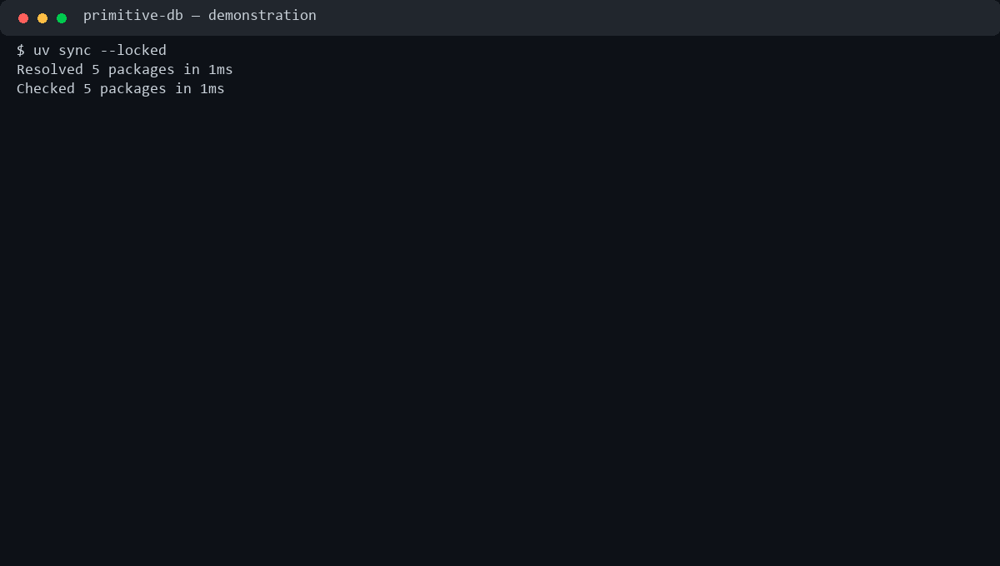

# Примитивная база данных

Домашнее задание №2. Консольное приложение для работы с таблицами и записями.
Данные сохраняются в JSON между запусками. Поддерживаются типы `int`, `str`, `bool`.

## Установка и запуск

Нужны Python 3.12 или новее и uv.

```console
git clone https://github.com/kiopio98/project2-nikanorov.git
cd project2-nikanorov
uv sync --locked
uv run database
```

Также можно запустить `uv run project` или `uv run python -m primitive_db.main`.
Обе консольные команды запускают одно приложение.

## Управление таблицами

```text
create_table users name:str age:int is_active:bool
list_tables
info users
drop_table users
```

Столбец `ID:int` добавляется автоматически. Его не нужно передавать при создании
таблицы или вставке записи. Одинаковые имена столбцов, неизвестные типы и повторное
создание таблицы отклоняются. Имена таблиц и столбцов — корректные идентификаторы
Python без пробелов и разделителей пути. Имена чувствительны к регистру.

## CRUD-операции

```text
insert into users values ("Sergei", 28, true)
insert into users values ("Anna Maria", 25, false)
select from users
select from users where age = 28
update users set age = 29 where name = "Sergei"
delete from users where ID = 1
```

Все пользовательские поля обязательны. Строки заключаются в одинарные или двойные
кавычки; внутри строк допустимы пробелы, запятые и слова `where`/`set`.
Для строк в двойных кавычках поддерживается JSON-экранирование, например `\"`.
Логические значения записываются как `true` или `false` без кавычек.

Условия используют равенство. Несколько условий можно соединить `and`, а несколько
присваиваний — запятыми:

```text
select from users where age=29 and is_active=true
update users set age=30, is_active=false where ID=1
```

`select` без `where` выводит все записи. У `update` и `delete` условие обязательно.
Изменять `ID` нельзя. Новая запись получает `max(ID) + 1`, для пустой таблицы — `1`.
Результаты выборки выводятся с помощью PrettyTable.

`help` выводит справку, `exit` завершает работу. Также обрабатываются EOF и Ctrl+C.

## Ошибки, подтверждения и кэш

- Ошибки ввода, отсутствия таблиц/столбцов и чтения файлов обрабатываются декоратором
  `handle_db_errors`; после ошибки можно ввести следующую команду.
- `drop_table` и `delete` запрашивают подтверждение. Для выполнения нужно ввести
  `y`, любой другой ответ отменяет операцию.
- `log_time` выводит время выполнения `insert` и `select` через `time.monotonic`.
- `create_cacher` хранит результаты одинаковых выборок в замыкании. Ключ включает
  актуальное содержимое таблицы и условие, поэтому после изменения данных выборка
  пересчитывается. Возвращается отдельная копия результата.

Метаданные находятся в `db_meta.json`, записи — в `data/<имя_таблицы>.json` относительно
текущей директории. При первом запуске файлы создаются автоматически. Повреждённый
JSON не перезаписывается пустыми данными. Сохранение использует временный файл и
`os.replace`. Одновременная запись из нескольких процессов не поддерживается.

## Демонстрация

[](docs/demo.cast)

[Запись asciinema](docs/demo.cast) · [Текст сеанса](docs/demo.txt)

В записи: установка окружения, запуск, создание таблицы, вставка, выборка,
обновление, повторная выборка, ошибка типа, подтверждение и отмена удаления,
удаление записи и таблицы. GIF — встроенный предпросмотр этой же записи.

Для воспроизведения файла в asciinema:

```console
asciinema play docs/demo.cast
```

## Проверки и сборка

```console
uv run python tests/check_project.py
uv run ruff check .
uv build
uvx twine check dist/*
```

Для make доступны `make install`, `make run`, `make lint`, `make test`, `make build`.
Проверки выполняются в отдельной временной директории и не затрагивают рабочую базу.
Проверяются CRUD, сохранение между процессами, валидация типов, кавычки, ошибки,
подтверждения, кэш и повреждённые файлы.

Собранный пакет можно установить как отдельную программу:

```console
uv tool install dist/primitive_db-0.1.0-py3-none-any.whl
database
```

## Структура

```text
src/primitive_db/
    __init__.py
    main.py          # точка входа
    engine.py        # цикл команд и вывод
    core.py          # таблицы и CRUD
    utils.py         # файлы JSON
    parser.py        # команды, values, where, set
    decorators.py    # обработка ошибок, подтверждения, время, кэш
    constants.py     # настройки и типы
tests/check_project.py
docs/demo.cast
docs/demo.gif
```

Реализация процедурная, без классов. Зависимости приложения — `prompt` и
`prettytable`, зависимость разработки — `ruff`; версии закреплены в `uv.lock`.
Работа велась в ветках `feature/table-management`, `feature/crud`,
`feature/decorators-cache`, `feature/tests-documentation` с объединением в `main`.
